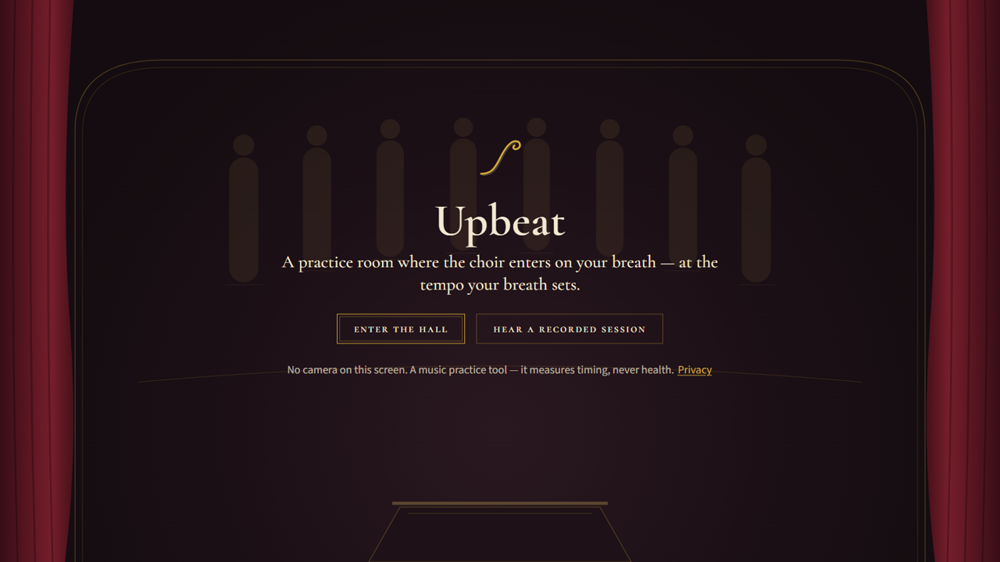
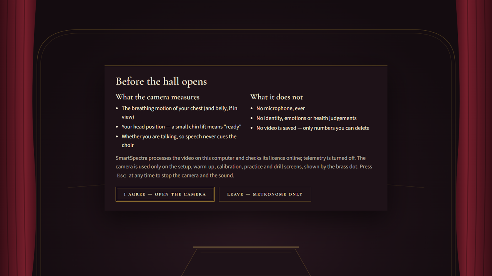
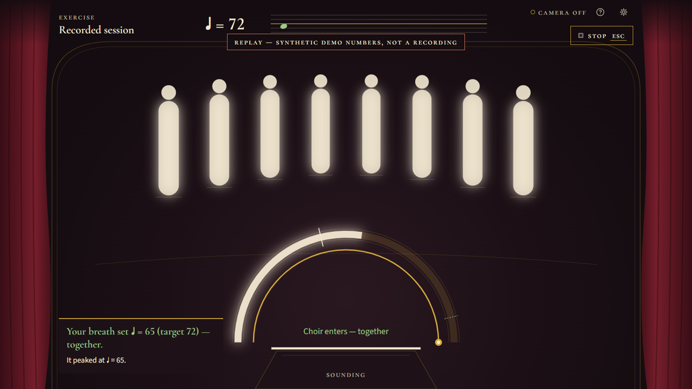
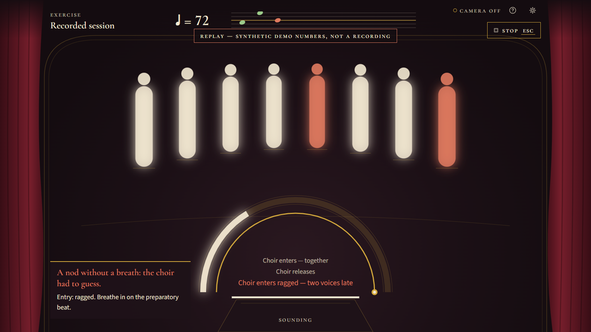
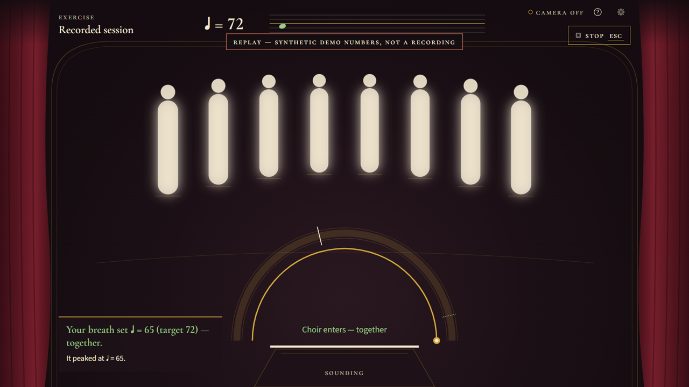
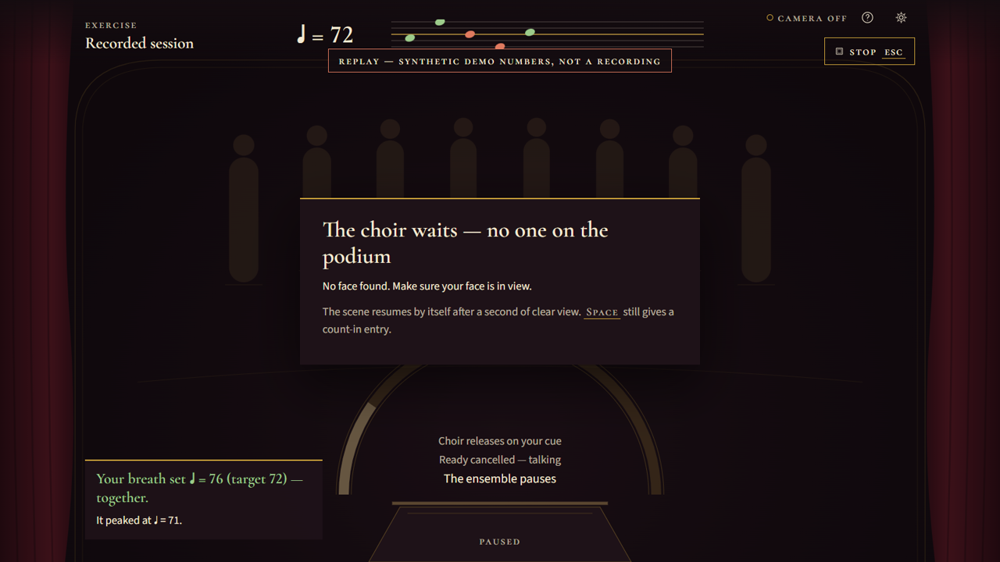
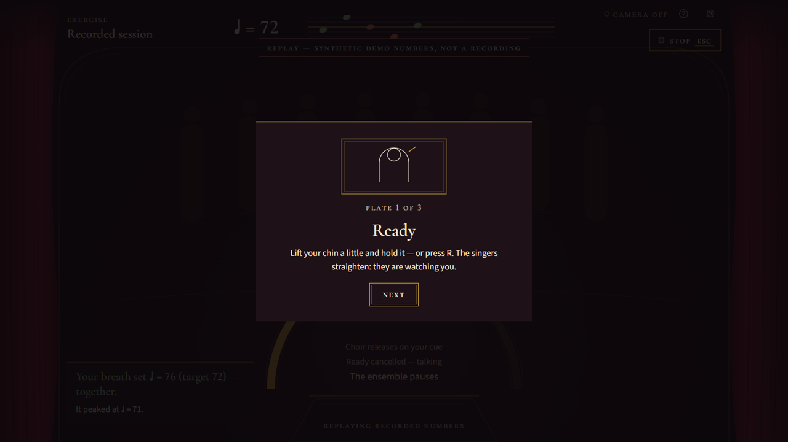
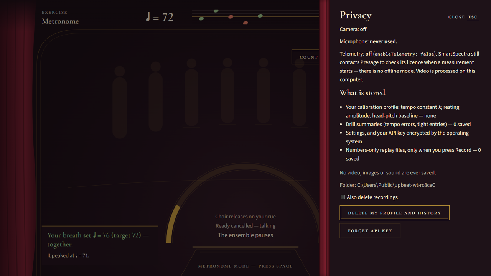

# Upbeat

**A virtual choir that enters on your breath, at the tempo your breath sets.**

Ensemble leaders cue an entry with a preparatory breath: the breath sets the tempo and makes everyone start together. Students can only practise this with a live ensemble, because recordings do not respond. Upbeat is a practice room: lift your chin, breathe in on the preparatory beat, and a choir (or string quartet) comes in on the downbeat, at the tempo your breath implied. Give it a shallow breath, or just a nod, and the entry is ragged. That contrast is the lesson.

The SmartSpectra breathing trace is the instrument. Built for the Presage SmartSpectra SDK Challenge 2026.

> Upbeat is a music practice tool. It reports musical timing only, never anything about breathing health, lung function, relaxation or stress. It never uses the microphone.

## Status

| | |
|---|---|
| App, cue engine, sound, scene, all screens | Built |
| Tests | 70 unit tests and 11 end-to-end tests (replay mode) pass |
| Scheduler precision | 100/100 plans within 0.021 ms (offline render) |
| **Live SmartSpectra session** | **Not yet run.** Thresholds are tuned on a synthetic breathing model only. Stage 1 (record real breaths, measure delays, retune) is next. See [docs/RESULTS.md](docs/RESULTS.md) |
| Bundled replay | **Synthetic** demo numbers, clearly labelled in the app. To be replaced with a real recording |

## Screenshots

| | |
|---|---|
|  |  |
| **Welcome**: no camera on this screen | **Consent**: camera only, never the microphone |
|  |  |
| **A breath-cued entry**: all eight voices together | **A nod without a breath**: two voices late (coral) |
|  |  |
| **Feedback**: the tempo the breath set, and its peak | **Camera covered**: the choir waits, nothing is guessed |
|  |  |
| **How it works** (H) | **Privacy**: what is stored, deletion, telemetry off |

The practice screenshots come from the bundled replay (**synthetic** numbers, labelled in the app).

## Walkthrough video

A narrated walkthrough (2 min) is attached to the [latest release](https://github.com/syncaimain/upbeat/releases/latest). It replays the bundled synthetic session through the same engine, so it shows the app, not a live person. The live demo is a separate video.

The narration is **Kokoro-82M** (Apache-2.0), an open-source voice model run offline through kokoro-onnx. To rebuild the video:

```bash
npm run walkthrough:capture                       # screenshots + screen/audio capture of the replay
pip install kokoro-onnx soundfile                 # plus kokoro-v1.0.onnx and voices-v1.0.bin (kokoro-onnx releases)
node scripts/walkthrough/compose.mjs walkthrough-capture <model-dir> walkthrough.mp4
```

## Setup from a fresh clone

Requirements: Node 20.19+ (Node 24 tested), and a supported SmartSpectra platform: Windows x64, macOS Apple Silicon, or Linux x64/ARM64 with glibc 2.35+.

```bash
npm install          # also pulls SmartSpectra's native runtimes (~344 MB, all platforms)
npm run build
npm start            # or: npm run dev
```

To sense your breath you need a SmartSpectra API key from https://physiology.presagetech.com. Paste it in **Setup**; it is encrypted with your OS keychain. For development only, you can instead put `SMARTSPECTRA_API_KEY=…` in a git-ignored `.env` (see `.env.example`).

**No key, no camera?** Choose **Hear a recorded session** on the first screen: it replays numbers through the same engine. **Metronome mode** (Space) works anywhere without a camera.

### First session

1. **Enter the hall**, then agree to the camera-only consent note.
2. **Setup:** paste your key, then **Check the hall**. This runs SmartSpectra's readiness check and opens the framing mirror; the SDK's own hints are shown as-is. Put the camera somewhere still, with your face and chest lit and in view (singers: the waist too).
3. **Warm-up:** the choir hums a tuning note for about 30 s while SmartSpectra's breathing measurement settles.
4. **Calibration** (about 90 s, once): 20 s of quiet breathing, then 9 preparatory breaths to a visual metronome at ♩ = 60, 90 and 120. Upbeat fits your personal tempo constant and shows the fit error. Above 15 %, exercises switch to a fixed tempo and the breath only times the entry.
5. **Practice.** Three "how it works" plates come first.

### Keys

| Key | Action |
|---|---|
| **R** | Ready (or lift your chin about 6°, held for 0.3 s) |
| **Space** | Count-in entry, no breath needed |
| **D** | Drills |
| **H** | How it works |
| **Esc** | Stop: camera and sound off within 1 s, from anywhere |

### Drills and results

- **Consistency:** 10 cues at one tempo.
- **Tempo ladder:** 60 → 120.
- **Match the tempo:** random targets.

Results are plotted on a five-line staff, with the mean and spread of tempo error and the % of tight entries. **Export teacher summary** saves a Markdown file of the numbers.

## How the cue engine works

All of it is pure TypeScript in `src/engine/` (no SDK, Svelte or Tone imports); every threshold is in [`config/cue.ts`](config/cue.ts) with its reason.

1. **Preprocess** the chest trace (`breathing.upperTrace`):
   - De-duplicate by timestamp.
   - One-pole 2 s high-pass, which feeds the breath arc and the resting amplitude.
   - 5-sample median.
   - Normalise to your resting amplitude (P90 − P10 of 20 s of quiet breathing), with the inhale made positive. Calibration detects which way an inhale moves the trace.
   - When stable and the chest is visible, the belly trace is averaged in.
2. **Ready gate.** Head pitch comes from three face landmarks (nose tip and outer eye corners, MediaPipe indices 1, 33 and 263; still to be verified on the SDK). A chin lift of 6° or more for 300 ms, or R, arms the ensemble. It disarms after 6 s, or as soon as you talk.
3. **Onset.** The smoothed slope must stay above 0.5 resting amplitudes per second for 120 ms. Its first 150 ms rise must also reach 1.6 rest/s, which separates a preparatory breath from a resting one. t0 is traced back to where the inhale began.
4. **Predict the beat:** `b = k / r`, from the early rise rate `r`. Here `k` is fitted per user by least squares on `1/b`, and `b` is clamped to 40–170 bpm. The downbeat `t0 + b` is mapped from SDK microseconds to the Web Audio clock (see [docs/TIMING.md](docs/TIMING.md)). If it is less than 120 ms away, the entry plays at once and the note says "too fast to follow".
5. **Entry quality**, decided 90 ms before the downbeat:
   - **Tight:** projected depth at least 1.6× rest, a steady rise, no talking. Voices are offset by N(0, 12 ms).
   - **Ragged:** a shallow breath (under 1.2×), talking, or a nod with no breath. Voices spread 60–250 ms, with two noticeably late. The singer columns light at their own times, so you see the stagger too.
6. **Confirm the peak** once the slope has stayed non-positive for 150 ms. The peak is interpolated between samples. Feedback reads "Your breath set ♩ = 84 (target 80) — together. It peaked at ♩ = 82." A tempo that was not measured is never shown.
7. **Release** (optional): after at least 1.5 s of sound, an exhale onset plus a head drop of 4° or more releases the ensemble together. Otherwise it fades after 4.5 s.

The scene pauses whenever SmartSpectra reports a problem (no face, multiple faces, chest not visible, excessive motion…). Breathing data that is not `stable` (the SDK needs about 30 s) never cues an entry.

## Consent and data handling

In short:
- Camera only, and only after an explicit in-app consent.
- Never the microphone.
- Telemetry off (`enableTelemetry: false`), and `requestInsight` is never called.
- SmartSpectra processes video locally and checks its licence online.
- Only numbers are stored: settings, the calibration profile, drill summaries, and replay files only when you press Record.
- Delete everything from the Privacy curtain.

Details, file paths and the shutdown sequence are in [docs/PRIVACY.md](docs/PRIVACY.md).

## Replay mode

- **Hear a recorded session** plays `static/fixtures/demo-session.jsonl`. It is currently **synthetic** (`npm run fixture` regenerates it), and the banner says so.
- **Settings → Record numbers** saves a real session (decoded numbers only, never video). It can be replayed from the Privacy curtain.
- To make a real recording the bundled demo, copy it over `static/fixtures/demo-session.jsonl`. The banner then reads "replay — recorded numbers".
- Replays are deterministic: the same file gives the same entries and drill scores, and a test checks this.

## Stage 1 tools

```bash
npm run probe     # build, then open the app with the probe link on the first screen
```

The probe:
- Logs decoded metrics as JSON lines.
- Shows sample rate, packet interval and delivery delay live.
- Draws the face landmarks with indices 1, 33 and 263 in gold, so you can confirm they are the nose tip and outer eye corners.
- Records the fixture protocol: 30 prep breaths (press R before each), 2 min of resting breath, 1 min of talking.

Then:

```bash
npm run analyze -- --prep fixtures/prep.jsonl --rest fixtures/rest.jsonl --talk fixtures/talk.jsonl
```

This prints the delays, detection rate, false entries and a separability table, ready to paste into [docs/RESULTS.md](docs/RESULTS.md).

## Tests

```bash
npm test             # 70 unit tests (engine, signal, gate, replay, privacy, SDK options)
npm run test:e2e     # builds, then 11 Playwright tests driving the app in replay mode (~4 min)
npm run typecheck
```

## Project layout

```
electron/        main.ts (window, IPC, safeStorage key, readiness, files), preload.ts, redact.ts
src/sense/       sdk.ts (the SmartSpectra integration), decode, gate, errors, pipeline, record, replay, driver
src/engine/      cue/ (readyGate, onset, predictTempo, entryQuality, confirmPeak, release, cueEngine),
                 timing/ (units, clocks, delay), signal/ (preprocess, headPose), calibration, drills, feedback
src/sound/       choirSynth (formant "ah" choir, tuning hum, click), quartetSampler (VSCO 2 CE), scheduler, voicing
src/scene/       Stage, Hall, Singers, BreathArc, Podium, ScoreStrip, Candles, Staff, Logo, Icon
src/flows/       Welcome, Consent, Setup, WarmUp, Calibration, Practice, Drills, Results, Timing, Probe, curtains, plates
src/stores/      session (controller), settings, profile
config/cue.ts    every threshold, with its reason
fixtures/        synth.ts (synthetic breathing model), real recordings go here
static/          samples/ (CC0 + licence), fixtures/demo-session.jsonl, icon
docs/            TIMING, RESULTS, PRIVACY, CREDITS, SDK-NOTES
```

## Limitations

- **Not validated on a live session yet.** All thresholds come from the plan or a synthetic model.
- The SmartSpectra breathing measurement needs a still camera, a still body, and face and chest lit and in view. Large motion gives confident wrong readings, which is why the scene pauses on `EXCESSIVE_MOTION`.
- The first ~30 s of every session is warm-up.
- Tempo is predicted from how a breath *starts*. A deeper breath rises faster, so depth can bias the predicted tempo. Calibration reports the fit error and falls back to fixed tempo when it is poor.
- Fast tempi: the prediction is ready about 0.3–0.5 s into the inhale, so above roughly 95–125 bpm (depending on delivery delay) entries play at once and say so.
- SmartSpectra authenticates online; there is no offline mode.
- macOS packaging needs a camera usage string and the library-validation entitlement (see the SDK notes). Not built here.

## Credits

- Fonts: Cormorant Garamond and Cormorant SC (Christian Thalmann), Source Sans 3 (Adobe), all SIL OFL 1.1.
- String samples: VS Chamber Orchestra Community Edition (Versilian Studios), CC0.
- Libraries: Tone.js, Svelte, Electron (MIT).

Full list with licences: [docs/CREDITS.md](docs/CREDITS.md). The DEV post draft is in [docs/DEV-POST.md](docs/DEV-POST.md).
