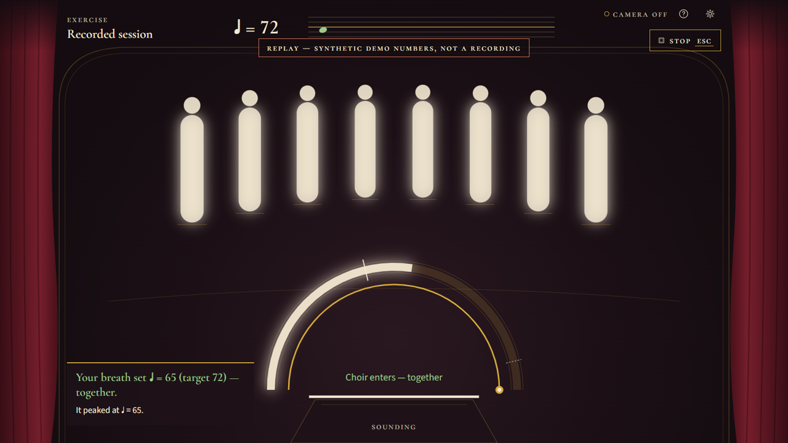
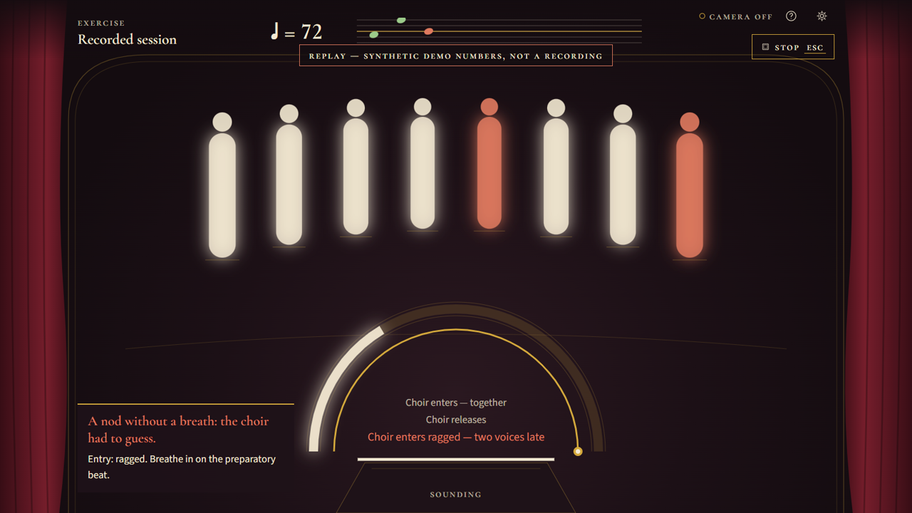

*This is a submission for the [Presage SmartSpectra SDK Challenge](https://dev.to/challenges/presage-2026-11-04).*

## What I built

**Upbeat** is a practice room for conductors, choir directors and chamber-group leaders.

When an ensemble leader cues an entry, the cue is a **preparatory breath**. The breath sets the tempo, and everyone comes in together on the downbeat. Students can only practise that with a live ensemble, because a recording doesn't follow you.

In Upbeat you:

- **lift your chin** (or press R): the singers straighten, watching you;
- **take a preparatory breath**: the virtual choir enters on the downbeat, **at the tempo your breath implied**;
- **give a shallow breath, or just a nod**, and the entry falls apart: two singers come in late. That contrast is the lesson.

The SmartSpectra breathing trace is the instrument.

## Demo

**Live demo (unedited, real breathing):** `<!-- PASTE YOUR LIVE VIDEO LINK HERE -->`

**Narrated walkthrough:** [walkthrough video](https://github.com/syncaimain/upbeat/releases/latest). This one replays the session bundled with the app, which is scripted, synthetic breathing numbers run through the same engine, so you can see every feature without a camera. The narration uses Kokoro-82M, an open-source voice, offline.

**Try it without a camera or key:** clone the repo, run `npm install && npm run build && npm start`, then choose **Hear a recorded session**.

## How SmartSpectra is used

Upbeat uses the Node/Electron SDK (`@smartspectra/node-sdk` 3.5.0):

- **The renderer helper**, fed by a camera stream the app owns. The stream is video only; the microphone is never requested.
- **Requested metrics:** the breathing bundle (chest and abdomen traces, breathing rate), `FACE_LANDMARKS` and `TALKING`. Nothing else.
- **What each signal does:**

| Signal | What Upbeat does with it |
|---|---|
| Chest (and belly) breathing trace | Detects the inhale onset, its early rise rate, its depth, and the peak |
| Breathing `stable` (confidence ≥ 45) | Gates every cue. The first ~30 s become a "tuning" warm-up while the choir hums |
| Face landmarks | Head pitch from the nose tip and outer eye corners: a held chin lift means "ready", and a head drop helps release the chord |
| Talking | Cancels a cue: speech never cues the choir |
| Validation status | Pauses the scene with SmartSpectra's own hint (no face, chest not visible, excessive motion…) |

**The interesting part is timing.** The entry has to sound *before* the breath's peak can be confirmed. So Upbeat predicts the beat from how the inhale **starts**: `beat = k / r`, where `r` is the rise rate over the first 150 ms and `k` is fitted per person in a 90-second calibration.

The entry is then scheduled sample-accurately on the Web Audio clock:

- SDK microsecond timestamps map to `performance.now()`, and then to `AudioContext` time via `getOutputTimestamp()`.
- The breath decides between **tight** and **ragged** 90 ms before the downbeat. Each of the eight voices gets its own offset: about ±12 ms when tight; spread 60–250 ms, with two late, when ragged.
- When the peak is confirmed, the note reads: *"Your breath set ♩ = 84 (target 80) — together. It peaked at ♩ = 82."*

## Design

"Concert hall at night":

- aubergine-black, brass and parchment, in Cormorant Garamond;
- eight singer light-columns that brighten at **their own** entry times, so a ragged entry is *seen* as staggered light as well as heard;
- a brass breath arc that fills with the live chest trace;
- the last ten entries as noteheads on a staff;
- programme notes for feedback, and settings that slide in as a velvet curtain.

Every sound has a caption, the keyboard covers everything (R, Space, D, H, Esc), and reduced motion is respected.

## Privacy and data handling

- **Camera only, after explicit consent. Never the microphone.**
- **Telemetry off** (`enableTelemetry: false`), and `requestInsight` is never called. SmartSpectra processes video on the computer and checks its licence online (there is no offline mode).
- **Only numbers are stored:** the calibration profile, drill summaries and settings, plus numbers-only replay files if you press Record. You can delete them all from the Privacy curtain. No video, images or audio are ever saved.
- **The API key** is encrypted with the operating system's keychain, kept in the main process, and never logged.
- **Esc stops** the camera and the sound within a second, from anywhere.
- **Upbeat is a music practice tool.** It reports musical timing only, never anything about breathing health.

## Honest status

- **Verified:**
  - 70 unit tests and 11 end-to-end tests pass;
  - the entry scheduler lands within **0.021 ms** of plan in an offline render of 100 entries;
  - replays are deterministic.
- **Tuned so far on a synthetic breathing model only:** the cue thresholds. The repo includes a probe (`npm run probe`) and an analysis script (`npm run analyze`) to retune them on real recordings. [docs/RESULTS.md](https://github.com/syncaimain/upbeat/blob/main/docs/RESULTS.md) lists every problem the synthetic tests caught, and what changed.
- **Known limits:**
  - SmartSpectra needs a still camera, face and chest lit and in view, and about 30 s to settle;
  - very fast breaths (above roughly 95–125 bpm, depending on delivery delay) are played immediately and flagged "too fast to follow";
  - a deeper breath rises faster, so depth can bias the predicted tempo. Calibration reports the fit error and falls back to a fixed tempo when it is poor.

## Tech

Electron · Svelte 5 · TypeScript (strict, with unit-safe time types) · Tone.js (formant-synthesised choir; string quartet from VSCO 2 Community Edition, CC0) · Vitest · Playwright.

Code: **https://github.com/syncaimain/upbeat**

Thanks to Presage for the SDK and the challenge.
