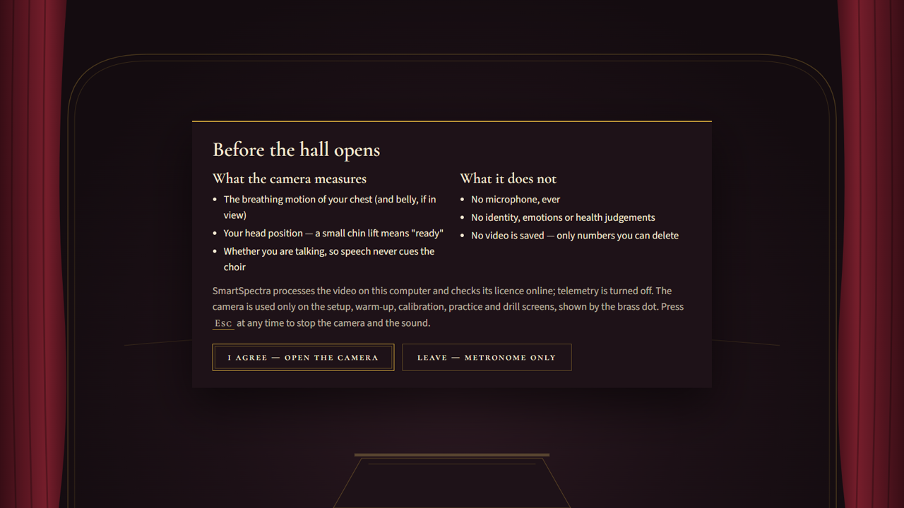
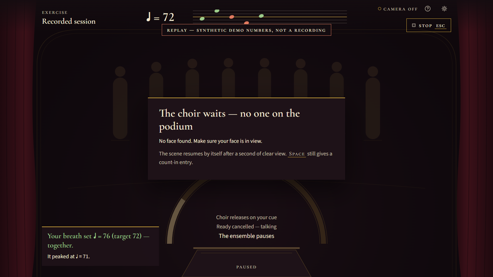

*This is a submission for the [Presage SmartSpectra SDK Challenge](https://dev.to/challenges/presage-2026-11-04)*

## What I Built

**Upbeat is a practice room for conductors, choir directors and chamber-group leaders, where a virtual choir comes in on your breath, at the tempo your breath sets.**

Every ensemble entry starts the same way. The leader lifts their head a little and takes a **preparatory breath**. That breath carries everything the musicians need: *when* to come in (on the next downbeat) and *how fast* (a quick breath means a quick tempo, a slow breath a broad one). Conducting teachers call it the most important gesture there is.

It is also nearly impossible to practise alone. A recording doesn't watch you, and a mirror doesn't play back. You only find out whether your breath "worked" when a real ensemble comes in together, or doesn't.

Upbeat closes that loop:

1. **Get ready.** Lift your chin slightly (or press **R**). The eight singers straighten; they're watching you.
2. **Breathe.** Take your preparatory breath. A brass arc fills with your breathing as you inhale.
3. **They come in.** On the downbeat, the choir enters at the tempo your breath implied, and a programme note tells you what your breath said: *"Your breath set ♩ = 84 (target 80) — together. It peaked at ♩ = 82."*

And the part that makes it a teacher: **give it a shallow breath, or just a nod, and the entry falls apart.** The singers have to guess, and two of them come in late. You *hear* it, and you *see* it: each singer is a column of light that brightens at its own entry time, so a ragged entry shows up as staggered light with the latecomers glowing coral.


**What else is in it:**

- **Warm-up as tuning.** SmartSpectra needs about 30 seconds before the breathing signal is reliable, so the choir hums a quiet tuning note meanwhile. The wait becomes part of the ritual.
- **A 90-second calibration.** Twenty seconds of quiet breathing, then nine preparatory breaths to a visual metronome at ♩ = 60, 90 and 120. This teaches Upbeat how *your* breath maps to tempo, and it reports how well that fit worked.
- **Drills.** *Consistency* (ten cues at one tempo), *Tempo ladder* (60 → 120) and *Match the tempo* (random targets). Results are plotted on a five-line staff, and there's a teacher summary export.
- **Release cues.** While the choir holds a chord, breathe out and drop your head slightly, and they finish together.
- **Choir or string quartet.** A formant-synthesised SATB choir singing "ah", or a quartet built from CC0 orchestral samples.
- **Metronome mode** (Space) when you have no camera: a count-in entry, so the app never dead-ends.
- **Works without a camera or key:** a bundled replay runs the full experience through the same engine.

## Demo

**Live demo:**



**Narrated walkthrough (2 min).** This walkthrough replays the session bundled with the app: scripted, synthetic breathing numbers run through the same engine the live camera feeds, so every feature appears on cue, including the failure cases. The narration is Kokoro-82M, an open-source voice model, run offline.



| | |
|---|---|
|  |  |
| Consent comes before any camera access | What your breath said, after every entry |
|  |  |
| Lose the camera and the choir waits; nothing is guessed | Three "how it works" plates (press H any time) |

## Code

**https://github.com/syncaimain/upbeat** (MIT)

```bash
git clone https://github.com/syncaimain/upbeat && cd upbeat
npm install          # also pulls SmartSpectra's native runtimes
npm run build
npm start            # then "Enter the hall" (camera + API key) or "Hear a recorded session" (no camera)
```

The README covers:
- setup from a fresh clone;
- the camera and iPhone setup (via Camo);
- replay mode, and how the cue engine works;
- privacy, limitations and credits.

Deeper notes are in `docs/`: `TIMING.md`, `RESULTS.md`, `PRIVACY.md`, `SDK-NOTES.md` and `CREDITS.md`.

## How It Responds to Human Signals

Upbeat uses the **Node/Electron SDK** (`@smartspectra/node-sdk` 3.5.0). It requests the **breathing bundle** (chest trace, abdomen trace, breathing rate), **face landmarks** and **talking**, and nothing else.

| Live signal | What the experience does with it, in real time |
|---|---|
| **Chest breathing trace** (plus the belly trace when stable) | The brass arc follows it continuously. Upbeat detects the **start of each inhale**, measures how fast it rises in the first 150 ms, how deep it goes, and when it peaks. |
| **Breathing confidence / `stable`** | No cue is ever taken from unstable data. During the first ~30 s the choir hums a tuning note; when breathing turns stable, the hum fades and the choir is "in tune". |
| **Face landmarks** | Nose tip and outer eye corners give head pitch. A chin lift held for 0.3 s means **"ready"**; a nod without a breath makes the choir **guess** (ragged); a head drop while breathing out **releases** the chord. The same points drive a framing guide in Setup ("← Move left", "Move back a little"). |
| **Talking** | Talking cancels a cue at once: speech never cues the choir, and the camera sees you talk, with no microphone involved. |
| **Validation status** | Covered lens, no face, multiple faces, chest not visible, too much motion: the stage **pauses** within a second, with SmartSpectra's own hint shown as-is. It resumes by itself after a second of clear view. |

### The hard part: predicting a beat before it happens

The choir has to sound **on the downbeat**, but the breath's peak (the end of the beat) can only be *confirmed* about 0.2 s after it happens. That's too late.

So Upbeat **predicts the beat from how the inhale begins**. A quicker preparatory breath rises faster, so `beat = k ÷ r`, where `r` is the early rise rate and `k` is fitted to you during calibration by least squares. The engine then:

1. **Finds the inhale onset.** The smoothed slope must stay above half a resting breath per second for 120 ms. The onset time is traced back to where the inhale really started.
2. **Predicts the downbeat** at onset + 150 ms.
3. **Schedules the entry on the Web Audio clock**, mapping times from SDK microseconds to `performance.now()` to `AudioContext` time with `getOutputTimestamp()` (so speaker latency is included).
4. **Decides tight or ragged 90 ms before the downbeat**, using the breath received so far:
   - **Tight:** a deep, steady breath with no talking. Voices are offset by about ±12 ms.
   - **Ragged:** voices spread 60–250 ms, with two late.
5. **Confirms the peak** afterwards and reports the measured tempo next to the predicted one. A tempo that wasn't measured is never shown.

If a breath is too fast to schedule ahead (the prediction isn't ready in time), the choir comes in at once and the note says so, rather than pretending.

```
SmartSpectra trace ─► detrend + median ─► onset (slope, 120 ms) ─► rise rate r ─► beat = k / r
        │                                                               │
        └── stable? talking? validation OK? ── gate ──┐                 ▼
                                                      └──► schedule on the AudioContext clock
                                                            8 voices × offsets (tight / ragged)
```

### How the SDK is wired

- **Main process:** `bindSmartSpectraIpc(window)`. The API key is kept here, encrypted with the OS keychain via Electron `safeStorage`.
  - The **readiness check** (`checkDeviceReadiness()`, verdict compared explicitly with `=== 'ready'`) also runs here, with telemetry off. It targets the camera you picked by name.
- **Preload:** the SDK preload bridge, bundled into a sandboxed preload.
- **Renderer:** `SmartSpectraSDK` from `@smartspectra/node-sdk/renderer`, fed with Upbeat's own `getUserMedia` stream:
  - video only, capped at 1280×720 and 30 fps, so virtual cameras like an iPhone via Camo can't starve the SDK below 25 fps;
  - metrics decoded with `decodeMetrics`.
- **Errors** such as authentication failure, credit exhausted, network error, no camera or a sustained low frame rate become a "programme note" over the paused stage. Each offers a way on: retry, settings, or metronome mode.

A few things differed from what I'd planned (decoded fields are camelCase, readiness exists only in the main process, and so on). I logged each one in `docs/SDK-NOTES.md`.

### Engineering I'm happy with

- **Unit-safe time.** Seconds, milliseconds and microseconds are distinct branded types, so a 1000× unit bug won't compile.
- **The cue engine is pure TypeScript.** It has no SDK, UI or audio imports and is driven entirely by timestamps. **70 unit tests** cover onset, prediction, quality, gating, framing and replay.
- **Replays are deterministic.** A numbers-only recording replays through the same engine and gives identical entries and drill scores every time; an end-to-end test checks this.
- **Sample-accurate audio.** An offline render of 100 entry plans lands within **0.021 ms** of plan, about one sample at 48 kHz.
- **I wrote down what broke.** Testing on a synthetic breath model caught several real bugs before any live session: resting breaths cueing false entries, a high-pass filter shifting peaks early, and a 100 ms onset bias. `docs/RESULTS.md` keeps that list, alongside a probe (`npm run probe`) and an analysis script (`npm run analyze`) for retuning on real recordings.

## Prize Categories

**Most Creative or Delightful Use.**

The inspiration is a moment every ensemble musician knows: the half-second before a downbeat, when twenty people watch one person breathe and then move as one. I wanted to make that moment practisable, and to make the breath itself the instrument rather than a number on a dashboard.

What I think makes Upbeat original:

- **The signal *is* the musical gesture.** Breathing isn't measured and displayed; it's *performed*. The SmartSpectra trace drives an ensemble the same way a real breath drives real singers.
- **It predicts rather than reacts.** The tempo comes from the first 150 ms of your inhale, so the choir arrives *with* you on the downbeat instead of after you.
- **Failure is the best part.** The ragged entry, with its staggered, coral-lit latecomers, turns an invisible skill into something you can hear and see. A nod alone gets you a choir that guesses wrong, and that's the lesson.
- **The waiting is part of the show.** The SDK's warm-up becomes the choir tuning up; a covered camera becomes "the choir waits".
- **It looks like a concert hall at night, not a dashboard:** brass and parchment, velvet curtains, a podium, a score strip with your last ten entries as noteheads.

It's playful, but built for real people: student conductors, choir directors, and the first violin who cues a string quartet.

## Consent and Data Handling

- **Explicit consent first.** Before any camera access, a consent note explains:
  - what is measured: the breathing motion of your chest and belly, your head position, and whether you are talking;
  - what isn't: no identity, emotions or health judgements, and **no microphone, ever**;
  - how to stop. **Leave** opens metronome-only mode, which never touches the camera.
- **The camera is on only when needed**: during setup framing, warm-up, calibration, practice and drills, shown by a brass "camera on" dot. It is off on Welcome and Results. **Esc** stops the camera and the sound within a second, from anywhere.
- **On-device processing.** SmartSpectra processes the video on the computer. It checks its licence online when a measurement starts (there is no offline mode), and Upbeat discloses this in the app.
- **SDK telemetry is off.** `enableTelemetry: false` is set on every SDK instance, including the readiness check; a unit test enforces this. `requestInsight` is never called, and **no AI services** are used by the app.
- **Only numbers are stored, locally:**
  - your calibration profile (tempo constant, resting amplitude, head-pitch baseline);
  - drill summaries and settings;
  - **only if you press Record**, numbers-only replay files.

  **No video, images or audio are ever saved.**
- **Retention and deletion.** Everything is kept until you delete it. The Privacy curtain shows the folder and offers **"Delete my profile and history"** (optionally with recordings) and **"Forget API key"**.
- **No sharing.** Nothing leaves the computer except SmartSpectra's licence check.
- **The API key** is encrypted with the OS keychain, kept in the main process and never logged. A redaction step is unit-tested.
- **Not a medical tool.** Upbeat makes no claims about breathing health, lung function, relaxation or stress. It reports musical timing only.

## Agent Session

<!-- Optional: upload the Claude Code transcript at https://dev.to/agent_sessions/new and embed it here.
     IMPORTANT before uploading: this session's transcript contains API keys that were pasted into the chat.
     Remove those parts when you slice it (or rotate the keys first), check it for any other personal details,
     and click "Make Public" before publishing. Then replace this comment with the embed. -->

Built with Claude Code as a coding partner. The agent session is embedded here.

---

**Tech:** Electron · Svelte 5 · TypeScript (strict) · Tone.js · Vitest · Playwright · Presage SmartSpectra Node SDK 3.5.0.
**Credits:**
- Fonts: Cormorant Garamond and Source Sans 3 (SIL OFL 1.1).
- String samples: VS Chamber Orchestra Community Edition (CC0).
- Walkthrough narration voice: Kokoro-82M (Apache-2.0).

Thanks to Presage for the SDK and the challenge.
